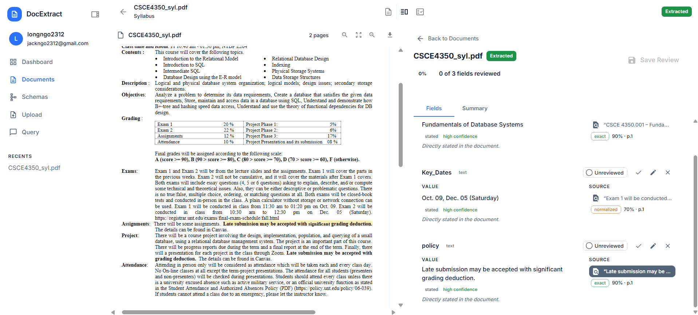
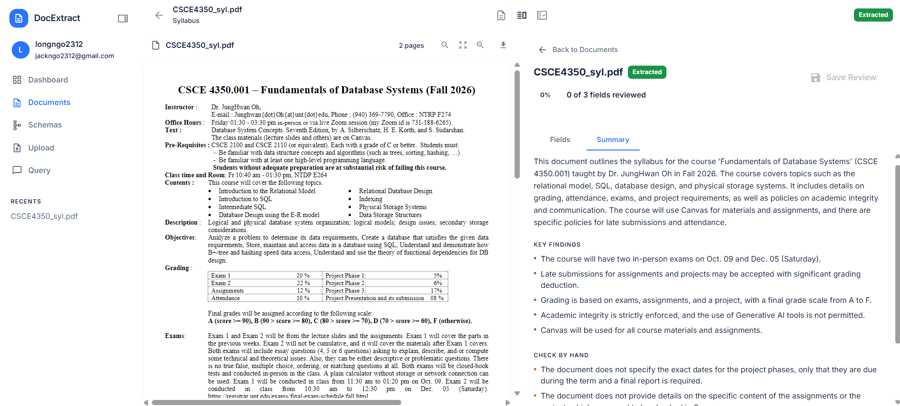
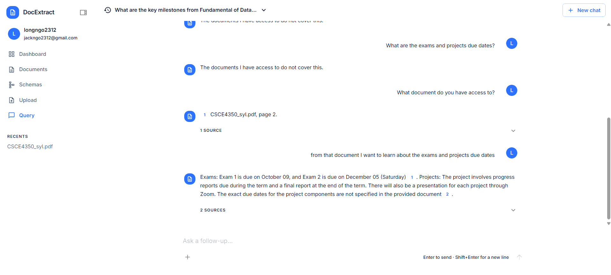
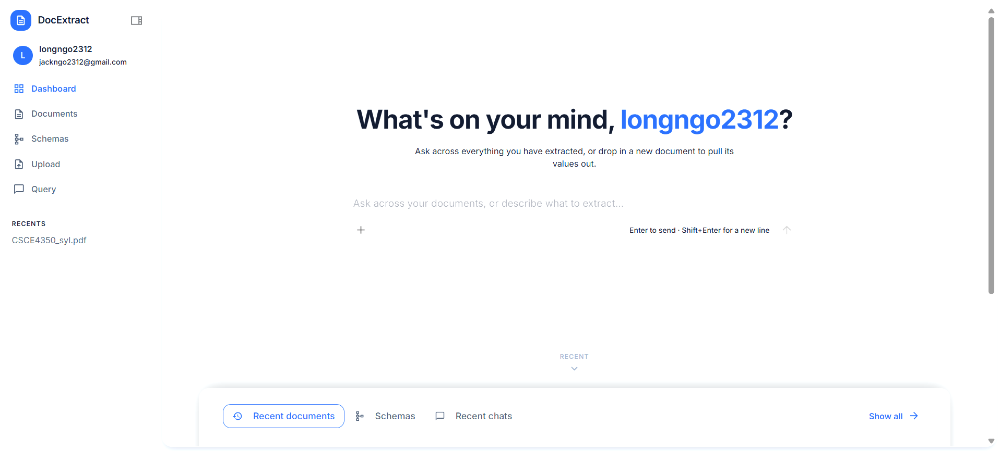

# Document Extraction

**Turn PDFs, scans and Office files into structured data you can check against the source, then ask questions across everything you've reviewed. It all runs on your own machine.**

```bash
cp api/.env.example api/.env        # then set JWT_SECRET (see below)
ollama pull qwen2.5:7b-instruct-q4_K_M
ollama pull nomic-embed-text
docker compose up --build
```

Open http://localhost:5173, register, define a schema ("invoice number: text, total: number, due date: date"), and upload a file. Each extracted value comes back with the quote it was taken from, highlighted on the page.



| Summary                                                                       | Chat with citations                                                             | Dashboard                                                     |
| ----------------------------------------------------------------------------- | ------------------------------------------------------------------------------- | ------------------------------------------------------------- |
|  |  |  |

## How it works

1. **Define a schema.** Fields typed as `text`, `number`, `date`, `boolean` or `enum`.
2. **Upload.** The file is parsed to text, and scanned pages and images go through OCR (Tesseract).
3. **Extract.** A background worker asks a local Ollama model to fill the schema. Each value is tied to a source quote and that quote's position on the page.
4. **Review.** You accept, edit or reject each value next to the original document.
5. **Ask.** Reviewed documents are split into passages, embedded and indexed in Qdrant. The chat answers with citations, and the server checks each citation before it reaches the browser.

Nothing the model produces reaches the search index until someone has reviewed it.

## Features

| Feature             | Description                                                                             |
| ------------------- | --------------------------------------------------------------------------------------- |
| File types          | PDF, DOCX, XLSX, PPTX, PNG/JPEG/TIFF, TXT, CSV, Markdown (25 MB max)                    |
| Source quotes       | Each value shows the passage it came from, highlighted in the PDF, image or text viewer |
| Review step         | Accept, edit or reject values; re-reviewing a document re-indexes it                    |
| Document summary    | An overview generated alongside the field values                                        |
| Chat over documents | Questions answered from reviewed documents, with citations you can click                |
| Per-user data       | Each user gets their own SQLite database, and search results are filtered by user       |
| Local only          | Ollama for the models, Qdrant for vectors, SQLite for everything else                   |

## Requirements

- [Docker](https://docs.docker.com/get-docker/) with Compose
- [Ollama](https://ollama.com/) running on the host (Docker reaches it at `host.docker.internal:11434`, so it can use your GPU)
- Enough VRAM for the chat model plus `nomic-embed-text`. The default 7B 4-bit model was sized for a 6 GB card.

## Quick start (Docker)

```bash
cp api/.env.example api/.env
node -e "console.log(require('crypto').randomBytes(48).toString('base64url'))"
```

Paste that output after `JWT_SECRET=` in `api/.env`, then:

```bash
ollama pull qwen2.5:7b-instruct-q4_K_M
ollama pull nomic-embed-text
docker compose up --build
```

The app is at http://localhost:5173. nginx serves the frontend and passes `/api` through to the API container, so the API needs no port of its own. SQLite files, uploads and Qdrant data are kept in Docker volumes (`sqlite_data`, `uploads`, `qdrant_data`).

## Local development

```bash
npm run setup
cp api/.env.example api/.env        # set JWT_SECRET as above
docker run -d -p 6333:6333 qdrant/qdrant:v1.19.0
npm run dev
```

`npm run dev` starts the API (http://localhost:3000, reloads on save) and the Vite dev server (http://localhost:5173) together.

| Script                                | What it does                                                      |
| ------------------------------------- | ----------------------------------------------------------------- |
| `npm run dev`                         | API and frontend together                                         |
| `npm run dev:api` / `npm run dev:web` | One side only                                                     |
| `npm run build`                       | Compile the API to `api/dist` and the frontend to `frontend/dist` |
| `npm run typecheck`                   | `tsc --noEmit` for both packages                                  |
| `npm run lint`                        | ESLint on the frontend                                            |

## Configuration

The API refuses to start if any required key is missing, and the error names the key.

**`api/.env`**

| Key            | Example                      | Notes                                                                                                        |
| -------------- | ---------------------------- | ------------------------------------------------------------------------------------------------------------ |
| `PORT`         | `3000`                       | API port                                                                                                     |
| `CORS_ORIGIN`  | `http://localhost:5173`      | The frontend's address exactly as the browser shows it. A mismatch shows up as CORS errors and failed logins |
| `JWT_SECRET`   | _(generate)_                 | Signs access tokens. Changing it signs everyone out of their current access token                            |
| `OLLAMA_URL`   | `http://localhost:11434`     | Docker Compose overrides this to `host.docker.internal`                                                      |
| `OLLAMA_MODEL` | `qwen2.5:7b-instruct-q4_K_M` | Chat and extraction model. Must be pulled and fit in VRAM                                                    |
| `QDRANT_URL`   | `http://localhost:6333`      | Docker Compose overrides this to the `qdrant` service                                                        |
| `NODE_ENV`     | `development`                | Optional. `production` makes the refresh cookie HTTPS-only                                                   |

**`frontend/.env`**

| Key            | Example                     | Notes                                                                              |
| -------------- | --------------------------- | ---------------------------------------------------------------------------------- |
| `VITE_API_URL` | `http://localhost:3000/api` | Built into the browser bundle, so never put secrets here. Docker builds use `/api` |

The embedding model (`nomic-embed-text`, 768 dimensions) is fixed in [ollama.ts](api/src/features/extraction/llms/ollama.ts). Changing it means re-indexing every document.

## API

Every route except `/api/auth/*` needs a valid access token.

| Route                                                                                             | Purpose                                                         |
| ------------------------------------------------------------------------------------------------- | --------------------------------------------------------------- |
| `POST /api/auth/register` · `login` · `refresh` · `logout`                                        | Accounts. Refresh uses an httpOnly cookie                       |
| `GET` `POST /api/schemas`, `GET` `PUT` `DELETE /api/schemas/:id`                                  | Schemas                                                         |
| `POST /api/documents` (multipart `file`), `GET /api/documents`, `GET` `DELETE /api/documents/:id` | Documents                                                       |
| `GET /api/documents/:id/file`                                                                     | The original file                                               |
| `GET` `PATCH /api/documents/:id/review`                                                           | Extracted values and review decisions                           |
| `POST /api/query`                                                                                 | Ask a question                                                  |
| `GET /api/query/status`, `POST /api/query/index`                                                  | Index status; index reviewed documents that are missing from it |
| `GET /api/query/sessions`, `GET` `DELETE /api/query/sessions/:id`                                 | Chat history                                                    |

## Checks

These are plain `assert` scripts with no test framework. Run them from `api/`:

```bash
npx tsx src/features/schema/schema.check.ts
npx tsx src/features/extraction/extraction.check.ts
npx tsx --env-file=.env src/features/RAG/rag.check.ts           # no services needed
npx tsx --env-file=.env src/features/RAG/rag.check.ts --live    # also uses Ollama and Qdrant
```

## Troubleshooting

| Symptom                                                       | Likely cause                                                       |
| ------------------------------------------------------------- | ------------------------------------------------------------------ |
| `Missing environment variables: ...` on start                 | `api/.env` is missing or incomplete. Copy `api/.env.example`       |
| CORS errors, or login works but you're immediately signed out | `CORS_ORIGIN` doesn't match the address in the browser bar exactly |
| Documents stay in "Processing" or end up "Failed"             | Ollama isn't reachable, or `OLLAMA_MODEL` hasn't been pulled       |
| `non-768-dim vector` error                                    | `nomic-embed-text` isn't pulled                                    |
| Chat finds nothing                                            | Only reviewed documents are searchable. Finish a review first      |

## Project layout

```
api/        Express 5 + TypeScript: parsing, extraction worker, RAG, auth
frontend/   React 19 + MUI + Zustand, built with Vite
docs/       Design notes for each build phase, plus the architecture PDF
```

The design notes in [docs/](docs/) explain why things work the way they do. Start with [Document Extraction Architecture Design.pdf](docs/Document%20Extraction%20Architecture%20Design.pdf), then [phase6-rag-query-agent.md](docs/phase6-rag-query-agent.md) for search and chat.

## Author

[](https://github.com/longngo2312)

Built on [Ollama](https://ollama.com/), [Qdrant](https://qdrant.tech/), [Tesseract.js](https://tesseract.projectnaptha.com/), [PDF.js](https://mozilla.github.io/pdf.js/) and [MUI](https://mui.com/).
